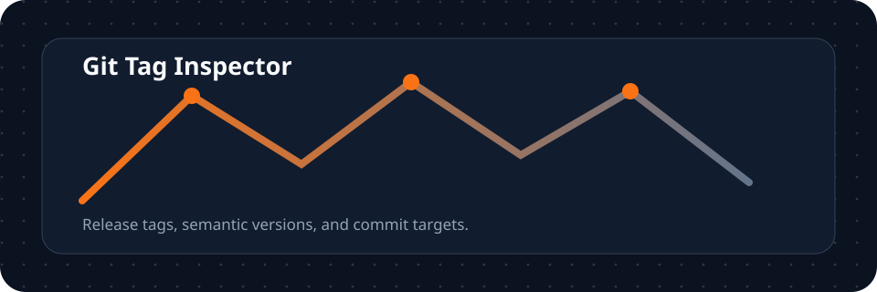

<div align="center">


[](LICENSE)



</div>

## :compass: Overview

A read-only Git CLI that inventories local tags, identifies non-semver names, distinguishes annotated from lightweight tags, and finds multiple tags pointing to the same commit.

## :sparkles: Features

- :white_check_mark: Lists tags with target commit and tag type
- :white_check_mark: Recognizes common semantic-version names
- :white_check_mark: Finds tags that point to the same commit
- :white_check_mark: Flags tags older than a configurable age

## :clapper: Demo

```bash
python main.py --repo . --stale-days 365
```

The example runs locally; no hosted service or upload is required.

## :rocket: Quick Start

```bash
python -m pip install -r requirements.txt
python main.py --repo .
```

Run `python main.py --help` to see all supported options.

## :toolbox: Tech Stack

- Python 3.10+ standard library and Git CLI
- Automated tests: unittest
- Local-first processing

## :file_folder: Folder Structure

```text
git-tag-inspector/\n├── main.py\n├── requirements.txt\n├── tests/test_core.py\n├── examples/README.md\n└── assets/illustration.svg
```

## :world_map: Roadmap

- [x] Core workflow and CLI
- [x] Example input and tests
- [ ] Additional report formats
- [ ] Continuous integration on supported platforms

## :handshake: Contributing

Issues and pull requests are welcome. Keep changes focused, document behavior changes, and add tests for new features.

## :page_facing_up: License

MIT - see [LICENSE](LICENSE).

<div align="center"></div>
